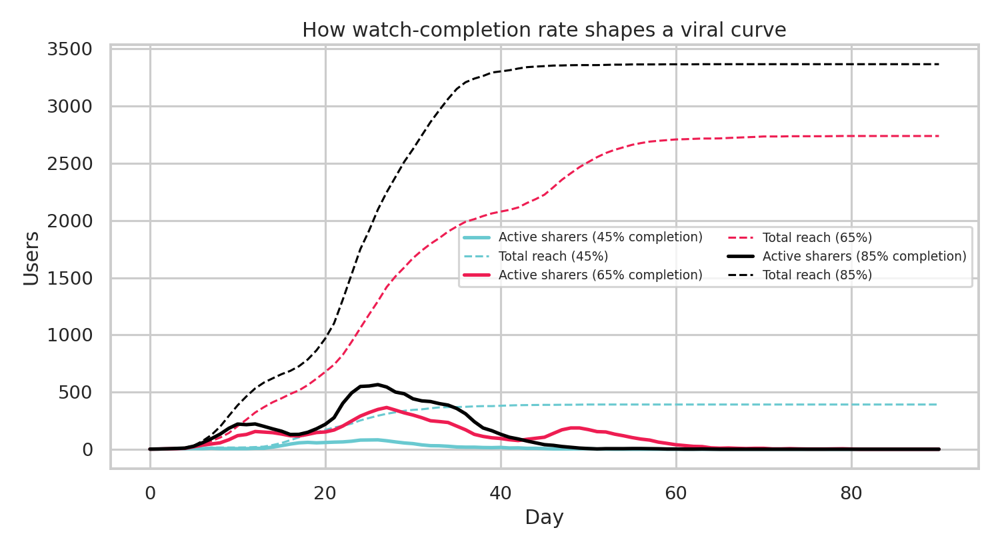
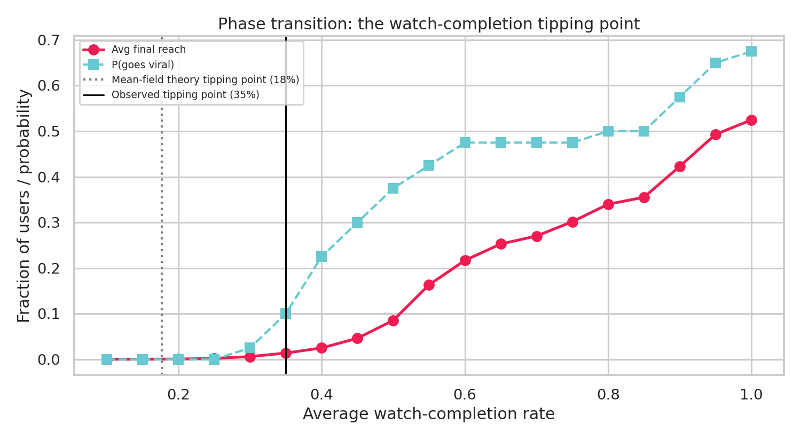
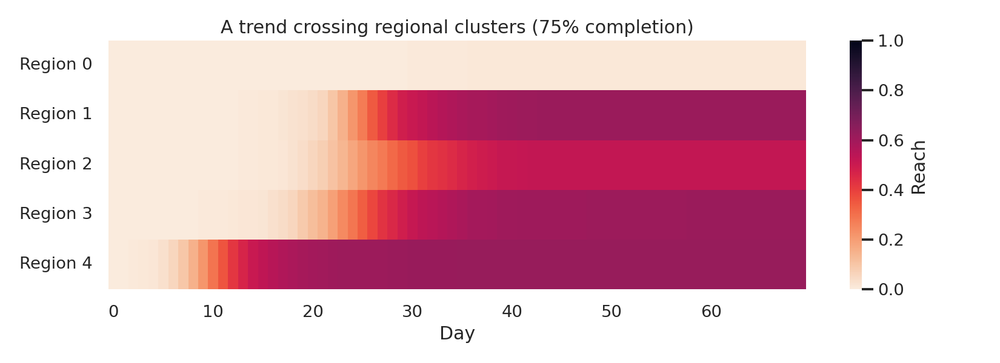
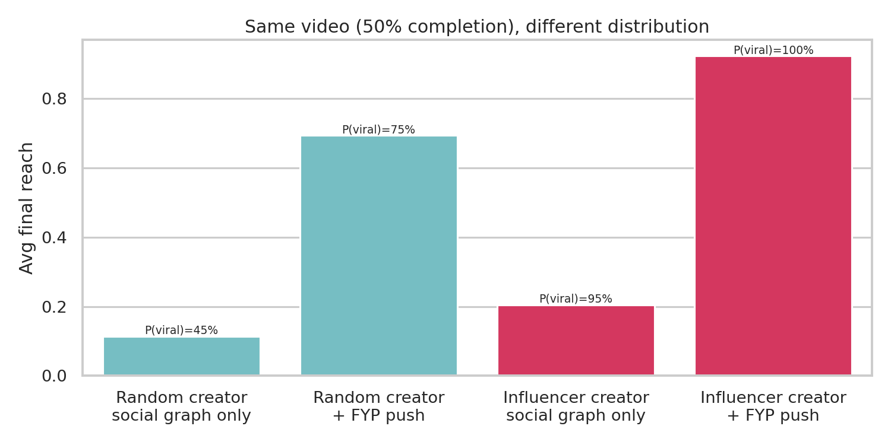

# 🦠 Bio-Viral: Trend Predictor & Social Graph Analyzer

**What if a TikTok video spread like a virus?** This project models content virality with the **SIR epidemic model** that epidemiologists use to track disease outbreaks, run on a 5,000-user synthetic social graph with influencers, friend clusters and regional communities.

| Epidemiology | TikTok |
|---|---|
| Susceptible | Hasn't seen the video |
| Infectious | Watched it and is actively sharing it |
| Recovered | Seen it, lost interest |
| Infection rate β | `share_probability × watch_completion_rate` |
| Recovery rate γ | Daily interest decay |
| R₀ | Avg. new viewers each sharer creates |



## Key findings

**1. Virality is a phase transition, not a slope.** Below roughly **35% watch completion**, videos almost never escape the creator's friend group (0 of 40 runs at ≤25%). Above it, the share of runs that go viral climbs steeply, and average reach rises from under 3% to over 50%.

**2. Textbook theory gets the tipping point wrong by ~2×.** The mean-field network formula `T_c = ⟨k⟩ / (⟨k²⟩ − ⟨k⟩)` predicts the tipping point at **18%** completion; simulation shows **~35%**. The gap comes from *clustering*: in tight friend groups, shares land on people who've already seen the video, so they're wasted. This is exactly why a simulation is needed rather than a formula.



**3. Trends cross regions through a small number of bridges, and sometimes don't.** In the example run below, the trend saturated its home region by day 14, jumped to three more regions around days 18 to 21, and **never reached Region 0 at all** despite being the same video. Each region jump also shows up as a second "wave" in the viral curve above.



**4. Influencers solve cold start; the algorithm sets the ceiling.** For the same mediocre video (50% completion), posting from the highest-degree user raised P(viral) from **45% → 95%**, but reach among the runs that went viral barely changed (~25% → ~22%). Adding a For You Page push (exposure to non-followers in proportion to how hot the video is) raised average reach to **69%** (random creator) and **92%** (influencer). Takeaway: on an interest-based feed, distribution matters more than the follower graph.



## How it works

```
viral_sim/
├── network.py     # Graph generation: power-law + clustering + regional communities
├── simulation.py  # Vectorised SIR engine (sparse matrix ops, no per-node Python loops)
└── analysis.py    # R₀, epidemic threshold theory, Monte Carlo sweeps, region crossing
run_experiments.py # Reproduces every figure + CSV in /figures and /results
app.py             # Interactive Streamlit dashboard
tests/             # Pytest: conservation laws, determinism, edge cases
```

**The social graph.** Each region is a Holme-Kim power-law cluster graph (heavy-tailed follower counts plus friend-of-friend triangles), and regions are stitched together with 150 random bridge edges. Result: 5,000 users, ~20,000 connections, mean degree 8, max degree 133.

**The simulation.** Each day, a susceptible user with *k* sharing friends sees the video with probability `1 − (1 − β)^k`. Instead of looping over 5,000 users, the number of infectious neighbours for *every* user is computed in a single sparse matrix-vector product (`A @ infectious`), so a 90-day run takes ~15 ms and the full 760-run parameter sweep finishes in seconds.

**The theory.** Transmissibility for discrete time is `T = 1 − γ(1−β) / (1 − (1−γ)(1−β))`. Setting it equal to `T_c` and solving for β gives the theoretical critical completion rate, which the sweep then tests empirically.

## Run it

```bash
pip install -r requirements.txt
python run_experiments.py      # regenerate figures/ and results/
streamlit run app.py           # interactive dashboard
pytest                          # 7 tests
```

## Limitations & next steps

- **Synthetic data.** The graph and rates are plausible but not fitted to real data. Next step: calibrate β and γ against a public cascade dataset (e.g. SNAP's Twitter or Digg cascades).
- **One video at a time.** Real feeds have competing content. An SIR model with multiple competing "strains" would capture attention competition.
- **Homogeneous users.** Everyone has the same share rate. Per-user interest vectors would let completion rate depend on user–content match, which is closer to how a recommender works.
- **FYP model is simple.** Exposure is proportional to current sharers; a real system would target by predicted engagement.
